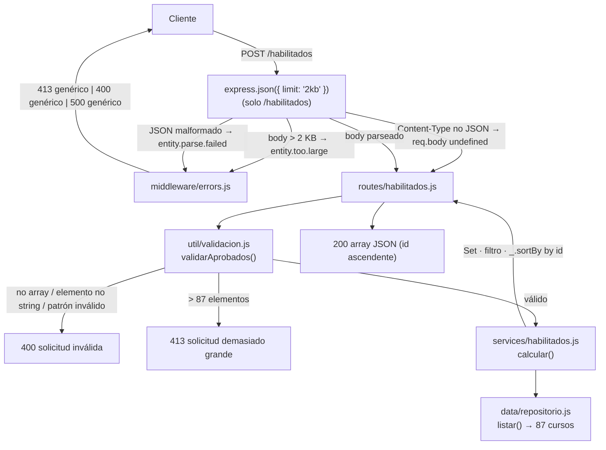

# Documento de Diseño: Endpoint `POST /habilitados`

## Overview

El endpoint `POST /habilitados` recibe un array de códigos de cursos aprobados por el alumno y devuelve la lista de cursos de la malla INF que el alumno está habilitado a llevar: aquellos no aprobados cuyos prerequisitos están todos presentes en el conjunto de aprobados (incluidos los cursos sin prerequisitos).

**Stack verificado:** Express 4.22.3 (instalado; `package.json` declara `^4.21.2`), body-parser 1.20.9 bundled, Node >= 22, Jest 29 + supertest 7, lodash 4.17.20. Sin TypeScript ni ORM.

**Verificaciones del PASO 0 sobre los datos reales:**

- Total de cursos: **87**.
- Cursos con `prerequisites` vacío: **26** (los tres aprobados del ejemplo, "1INF25", "1INF27" y "1INF49", están entre ellos).
- Con `["1INF25","1INF27","1INF49"]` el resultado es exactamente **27 cursos**: 23 sin prerequisitos + 4 con prerequisitos ya aprobados (1INF29, 1INF30, 1INF31, 1INF32).
- Referencias colgantes (prerequisito que no existe en la malla): **0**. Se confirma con un test de integridad de datos.
- El campo `id` de cada curso **es** el código ("1INF25", "INF238", etc.).
- `GET /cursos` devuelve los cursos en orden de inserción del JSON; `POST /habilitados` ordenará por `id` ascendente explícitamente (decisión propia del nuevo endpoint, no una inconsistencia).
- `req.body` es `undefined` cuando el `Content-Type` no es `application/json` (express.json no parsea); el diseño usa `req.body?.aprobados` para evitar un `TypeError` que terminaría en 500.

---

## Architecture

### Capas del endpoint

| Capa | Archivo | Responsabilidad |
|------|---------|----------------|
| Ruta | `src/routes/habilitados.js` | Punto de entrada HTTP; orquesta validación → servicio → respuesta |
| Validación | `src/util/validacion.js` | Valida tipo de `aprobados`, tipo de cada elemento, límite de 87 (pre-deduplicación), patrón estricto de cada código (con guarda `\n`) |
| Servicio | `src/services/habilitados.js` | Lógica pura de cálculo; devuelve cursos habilitados ordenados por `id` |
| Repositorio | `src/data/repositorio.js` | Ya existente; provee `listar()` con los 87 cursos |
| Middleware | `src/middleware/errors.js` | Error handler existente extendido: mapea errores del body-parser (413/400) y no filtra detalles internos |
| Registro | `src/app.js` | Monta `express.json({ limit: '2kb' })` solo para `/habilitados` y registra la ruta |

### Diagrama de componentes y flujo



### Flujo del request

```
POST /habilitados
  │
  ├─ [express.json limit 2kb — solo /habilitados]
  │     ├─ body > 2 KB          → entity.too.large   → middleware → 413 genérico
  │     ├─ JSON malformado      → entity.parse.failed → middleware → 400 genérico
  │     └─ Content-Type no JSON → req.body undefined (no error de parser)
  │
  ├─ routes/habilitados.js
  │    ├─ validacion.validarAprobados(req.body)   // req.body?.aprobados
  │    │    ├─ ¿aprobados es Array?              → no: 400 "solicitud inválida"
  │    │    ├─ ¿todos los elementos son string?  → no: 400 "solicitud inválida"
  │    │    ├─ ¿longitud > 87?                    → sí: 413 "solicitud demasiado grande"
  │    │    └─ ¿código incluye '\n' o falla el patrón? → sí: 400 "solicitud inválida"
  │    │
  │    └─ services/habilitados.calcular(aprobados)
  │         ├─ Set de aprobados (deduplicado)
  │         ├─ repositorio.listar() → 87 cursos
  │         ├─ filtro: !set.has(curso.id) && curso.prerequisites.every(r => set.has(r))
  │         └─ _.sortBy(resultado, 'id')
  │
  └─ res.json(cursos) → 200 con array JSON plano, id ascendente
```

**Complejidad:** O(n·p), con n = 87 cursos y p = prerequisitos promedio. 87 cursos × máximo ~4 prerequisitos ≈ 350 operaciones `Set.has()`, completamente dominadas por el I/O HTTP; esto justifica el umbral de < 300 ms de RS-1.3. No se necesita memoización ni índice adicional: el recorrido es lineal.

---

## Components and Interfaces

### `src/util/validacion.js`

```js
// src/util/validacion.js
const PATRON_CODIGO = /^(?:[0-9][A-Z]{3}[0-9]{2}|[A-Z]{3}[0-9]{3})$/;
const MAX_APROBADOS = 87;

function validarAprobados(body):
  aprobados = body?.aprobados
  if (!Array.isArray(aprobados)):        return { status: 400, body: { error: 'solicitud inválida' } }
  if (!aprobados.every(e => typeof e === 'string')): return { status: 400, body: { error: 'solicitud inválida' } }
  if (aprobados.length > 87):            return { status: 413, body: { error: 'solicitud demasiado grande' } }
  for each codigo in aprobados:
    if (codigo.includes('\n') || !PATRON_CODIGO.test(codigo)): return { status: 400, body: { error: 'solicitud inválida' } }
  return null   // válido
```

**Nota técnica obligatoria sobre `$` y `\n`:** el patrón es `/^(?:[0-9][A-Z]{3}[0-9]{2}|[A-Z]{3}[0-9]{3})$/` **sin** el flag `m`. En JavaScript, `$` sin flag `m` ancla al final del string **o antes de un `\n` final**, de modo que `"1INF30\n"` pasaría el regex. El diseño adopta la guarda explícita `!codigo.includes('\n')` en la función de validación, **antes** de aplicar el regex (alternativa descartada: reemplazar `$` por el lookahead `(?!\n)$`).

**Nota sobre el conteo:** el límite de 87 elementos se evalúa **antes** de deduplicar. Si el conteo fuera post-deduplicación, 5 000 repeticiones del mismo código eludirían el límite de RS-1.

### `src/services/habilitados.js`

```js
// src/services/habilitados.js
const _ = require('lodash');
const repositorio = require('../data/repositorio');

function calcular(aprobados):
  set = new Set(aprobados)                        // deduplicado aquí (tras validar conteo pre-dedup)
  todos = repositorio.listar()                    // 87 cursos
  habilitados = todos.filter(curso =>
    !set.has(curso.id) &&
    curso.prerequisites.every(req => set.has(req))
  )
  return _.sortBy(habilitados, 'id')
```

- `set.has(req)` usa pertenencia literal: un prerequisito se considera aprobado si su código está en el Set, exista o no en la malla (decisión 3).
- `prerequisites.every(...)` sobre un array vacío retorna `true` vacuamente, por lo que los 26 cursos sin prerequisitos (no aprobados) quedan habilitados.

### `src/routes/habilitados.js`

```js
// src/routes/habilitados.js
const express = require('express');
const { validarAprobados } = require('../util/validacion');
const habilitadosService = require('../services/habilitados');

const router = express.Router();

router.post('/', (req, res) => {
  const error = validarAprobados(req.body);   // maneja req.body undefined internamente
  if (error) return res.status(error.status).json(error.body);

  const cursos = habilitadosService.calcular(req.body.aprobados);
  return res.json(cursos);
});

module.exports = router;
```

Los errores no controlados dentro de la ruta o el servicio propagan al middleware de errores, que responde 500 genérico.

### `src/middleware/errors.js` (extendido)

```js
function errorHandler(err, req, res, next) { // eslint-disable-line no-unused-vars
  if (err.type === 'entity.too.large') {
    return res.status(413).json({ error: 'solicitud demasiado grande' });
  }
  if (err.type === 'entity.parse.failed') {
    return res.status(400).json({ error: 'solicitud inválida' });
  }
  return res.status(500).json({ error: 'error interno del servidor' });
}
```

**Garantía de no fuga:** la respuesta nunca incluye `err.stack`, `err.message` ni ningún dato derivado del error original. Los errores del body-parser llegan aquí como errores de middleware (no como excepciones en el callback de la ruta), por eso el mapeo debe vivir en el middleware y no en la ruta.

### Registro en `src/app.js`

```js
// express.json con límite 2 KB solo para la ruta /habilitados,
// montado antes de la ruta como primera barrera de DoS.
// La instancia global express.json() (sin límite) sigue atendiendo el resto.
app.use('/habilitados', express.json({ limit: '2kb' }), require('./routes/habilitados'));
```

`GET /cursos` no recibe body, por lo que el límite reducido en `/habilitados` no lo afecta.

---

## Data Models

### Request

```json
{
  "aprobados": ["1INF25", "1INF27", "1INF49"]
}
```

| Campo | Tipo | Restricciones |
|-------|------|---------------|
| `aprobados` | `string[]` | Array; 0–87 elementos (contados antes de deduplicar); cada código cumple `^(?:[0-9][A-Z]{3}[0-9]{2}|[A-Z]{3}[0-9]{3})$` y no contiene `\n` |

### Response 200

Array plano de objetos curso con la misma forma que `GET /cursos`, ordenado por `id` ascendente:

```json
[
  { "id": "1INF29", "name": "...", "credits": 5, "cycle": 6, "type": "obligatorio", "prerequisites": ["1INF25"] },
  ...
]
```

El modelo del repositorio ya incluye `prerequisites` en cada curso, por lo que la respuesta lo incluye (consistencia con `GET /cursos`).

### Response de error

```json
{ "error": "<mensaje genérico>" }
```

| Código HTTP | Mensaje (constante) |
|-------------|---------------------|
| 400 | `"solicitud inválida"` |
| 413 | `"solicitud demasiado grande"` |
| 500 | `"error interno del servidor"` |

Nunca se usa `err.message` ni se refleja el valor recibido en la respuesta.

---

## Error Handling

### Middleware global de errores (extensión de `src/middleware/errors.js`)

```js
function errorHandler(err, req, res, next) { // eslint-disable-line no-unused-vars
  if (err.type === 'entity.too.large') {
    return res.status(413).json({ error: 'solicitud demasiado grande' });
  }
  if (err.type === 'entity.parse.failed') {
    return res.status(400).json({ error: 'solicitud inválida' });
  }
  return res.status(500).json({ error: 'error interno del servidor' });
}
```

**Garantía de no fuga:** la respuesta nunca incluye `err.stack`, `err.message` ni ningún dato derivado del error original. Los mensajes son constantes: `"solicitud inválida"` (400), `"solicitud demasiado grande"` (413), `"error interno del servidor"` (500).

**Por qué el mapeo vive en el middleware y no en la ruta:** Express captura los errores del body-parser (`entity.too.large`, `entity.parse.failed`) como errores de middleware, no como excepciones dentro del callback de la ruta; el mapeo centralizado 413/400/500 evita fugas y código duplicado.

### Matriz de errores del endpoint

| Origen del error | Código | Body (constante) |
|------------------|--------|------------------|
| Body > 2 KB (`entity.too.large`) | 413 | `{"error": "solicitud demasiado grande"}` |
| JSON malformado (`entity.parse.failed`) | 400 | `{"error": "solicitud inválida"}` |
| `Content-Type` no JSON → `req.body` undefined → validación falla | 400 | `{"error": "solicitud inválida"}` |
| `aprobados` no es array, elemento no string, código con formato inválido o con `\n` | 400 | `{"error": "solicitud inválida"}` |
| Array con más de 87 elementos (contados antes de deduplicar) | 413 | `{"error": "solicitud demasiado grande"}` |
| Error interno no controlado | 500 | `{"error": "error interno del servidor"}` |

El uso de `req.body?.aprobados` en la validación evita un `TypeError` (que produciría un 500) cuando `req.body` es `undefined` por `Content-Type` incorrecto.

---

## Correctness Properties

*Una propiedad es una característica o comportamiento que debe cumplirse en todas las ejecuciones válidas del sistema: una afirmación formal sobre lo que el sistema debe hacer. Las propiedades sirven de puente entre las especificaciones en lenguaje natural y las garantías de corrección verificables automáticamente.*

### Property 1: Bicondicional de habilitación

*Para cualquier* subconjunto de códigos aprobados válidos, un curso aparece en la respuesta **si y solo si** (a) su `id` no está en el conjunto de aprobados **y** (b) todos los elementos de su array `prerequisites` están en el conjunto de aprobados (condición que se cumple vacuamente cuando `prerequisites` está vacío).

**Validates: Requirements 2.1, 2.2, 2.3, 2.4** *(RF-2.1–RF-2.4)*

### Property 2: Rechazo universal de códigos con formato inválido

*Para cualquier* array que contenga al menos un elemento que no cumpla el patrón `^(?:[0-9][A-Z]{3}[0-9]{2}|[A-Z]{3}[0-9]{3})$` o que contenga `\n` (cadena vacía, minúsculas, espacios, inyección, truncados, caracteres especiales, salto de línea final), la respuesta debe ser 400 con body exactamente `{"error":"solicitud inválida"}`.

**Validates: Requirements 2.1** *(RS-2.1)*

### Property 3: No fuga de información interna en respuestas de error

*Para cualquier* request que provoque una respuesta de error (400, 413 o 500), el body serializado como string no debe contener ninguna de las cadenas: `"stack"`, `"C:"`, `"\\"`, `"src/"`, ni `": "` seguido de un path de sistema.

**Validates: Requirements 2.2** *(RS-2.2)*

### Property 4: Idempotencia de duplicados

*Para cualquier* array de aprobados válido (dentro del límite de 87 elementos), enviar el mismo array con elementos duplicados debe producir una respuesta idéntica a enviar el array deduplicado. Es decir, `calcular(["1INF25","1INF25"])` ≡ `calcular(["1INF25"])`.

**Validates: Requirements 2.3** *(RF-2.3 — idempotencia de duplicados)*

### Property 5: Tolerancia a códigos inexistentes con formato válido

*Para cualquier* array de aprobados válido, añadir un código con formato correcto pero que no exista en la malla (p. ej. `"INF999"`) no debe cambiar el conjunto de cursos habilitados retornados.

**Validates: Requirements 2.3** *(RF-2.3 — códigos inexistentes; pertenencia literal en el Set. Nota: un prerequisito que referencie un código inexistente solo puede satisfacerse si ese código está en el Set de aprobados.)*

---

## Decisiones de Diseño para Casos No Definidos

| # | Decisión | Comportamiento | Razón |
|---|----------|---------------|-------|
| 1 | Array vacío `[]` | 200 con los 26 cursos sin `prerequisites` | Caso real del alumno nuevo de ciclo 5 sin aprobados; `prerequisites.every()` sobre array vacío es `true` vacuamente |
| 2 | Duplicados en `aprobados` | Deduplicar con `Set`, no error; **el límite de 87 se cuenta antes de deduplicar** | `aprobados` es semánticamente un conjunto; si el conteo fuera post-deduplicación, 5 000 repeticiones del mismo código eludirían el límite de RS-1 |
| 3 | Código con formato válido pero inexistente en la malla | No se rechaza (no 400 ni 404); el cálculo usa pertenencia literal en el Set; un curso se habilita si TODOS sus prereqs están en el Set, existan o no en la malla | El alumno pudo aprobar cursos fuera de la malla simplificada (p. ej. Estudios Generales) que sí figuran como prerequisito |
| 4 | Minúsculas, espacios, `\n` finales (`"1inf25"`, `" 1INF25 "`, `"1INF30\n"`) | 400 `"solicitud inválida"`; sin trim ni toUpperCase silenciosos. Guarda explícita `!codigo.includes('\n')` **antes** del regex (en JS, `$` sin flag `m` ancla antes de un `\n` final) | RS-2 exige patrón estricto; normalizar ampliaría la superficie de entrada sin justificación funcional |
| 5 | Aprobados incoherentes (incluyen cursos cuyos requisitos no están aprobados) | Aceptar sin validar coherencia | El historial académico es un dato externo; validar su coherencia interna excede el alcance del servicio |
| 6 | Orden de la respuesta | `id` ascendente (`_.sortBy`) | Determinista para tests; `GET /cursos` NO ordena (devuelve orden de inserción del JSON), así que este es un comportamiento explícito del nuevo endpoint |
| 7 | Forma del objeto en la respuesta | `{ id, name, credits, cycle, type, prerequisites }` | El modelo de repositorio ya incluye `prerequisites`; consistencia con `GET /cursos` |
| 8 | Body de error | `{ "error": "<mensaje genérico>" }`; nunca `err.message` ni reflejar el valor recibido; mensajes constantes | Convención del proyecto; sin detalles internos |
| 9 | `Content-Type` incorrecto (no `application/json`, p. ej. `text/plain`) | 400 `"solicitud inválida"`: express.json no parsea → `req.body` es `undefined` → `req.body?.aprobados` es `undefined` → validación falla | Un solo camino de error sin lógica especial de 415; usar `req.body?.aprobados` evita un `TypeError` → 500 |
| 10 | JSON malformado (entity.parse.failed) | 400 genérico mapeado en el middleware global de errores | El parser emite error con detalle interno; el middleware lo convierte a 400 sin detalles |
| 11 | Body demasiado grande (entity.too.large) | 413 genérico vía el middleware global; límite 2 KB configurado en `express.json({ limit: '2kb' })` para cortar antes de parsear | Rechaza en el parser, primera barrera de DoS (hallazgo: payload de ~45 KB dejó el servidor 40 s ocupado); el 413 no debe filtrar detalles |
| 12 | Prerequisito que referencia código inexistente en los datos | Tratado como no aprobado salvo que esté en el Set (coherente con decisión 3) | PASO 0 verificó 0 referencias colgantes; test de integridad de datos confirma que sigue en cero |
| 13 | Ciclos en los datos | No afectan el cálculo (solo pertenencia en el Set; no hay recorrido de grafo) | Sin validación en runtime; se verifica con test de integridad de datos |
| 14 | Límite de 87 elementos | Fijado en requirements.md. **Tensión documentada:** dado que la decisión 3 permite códigos fuera de la malla, un alumno que aprobó cursos extra teóricamente podría enviar más de 87; el límite NO se cambia aquí | Decisión aceptada conscientemente; requirements.md ya fija 87 y el conteo es pre-deduplicación |

**Propuestas originales del diseñador (registro de trazabilidad):**

| ID | Propuesta |
|----|-----------|
| P-D1 | Conteo de duplicados se evalúa antes de deduplicar |
| P-D2 | Guarda `!str.includes('\n')` adicional al regex para manejar `$` vs `\n` en JS |
| P-D3 | fast-check como devDependency para PBT (única dep nueva) |
| P-D4 | `express.json({ limit: '2kb' })` montado solo en `/habilitados`, no globalmente |
| P-D5 | Orden de respuesta: `id` ascendente con `_.sortBy` (GET /cursos NO ordena) |
| P-D6 | Límite de 87 elementos contado pre-deduplicación, con nota de tensión con decisión 3 |

---

## Gates de CI/CD

Los siguientes gates se integran en `.github/workflows/ci.yml`. Se necesita `permissions: contents: read` a nivel de workflow y `security-events: write` exclusivamente en el job de CodeQL.

| Gate | Herramienta | Umbral | Acción | Etapa | Razón |
|-----|-------------|--------|--------|-------|-------|
| a) SCA | `npm audit --audit-level=high` | Cualquier vulnerabilidad alta/crítica | **BLOQUEA** | Antes de `npm test`, al inicio del job principal (push y PR a `main`) | Política de TI + fallar rápido; no depende del resultado del build |
| b) Secretos | `gitleaks-action` con `fetch-depth: 0` | Cualquier hallazgo en el historial completo | **BLOQUEA** | Primer step de cualquier job (push y PR), antes que todo | Un secreto commiteado sigue expuesto aunque se borre; escanear historial completo |
| c) Cobertura | `npx jest --coverage --coverageThreshold='{"global":{"lines":80}}'` sobre `src/**/*.js` | >= 80 % líneas | **BLOQUEA** | Dentro del step de test del job principal | Política de TI; sin umbral bloqueante la cobertura decae con el tiempo |
| d) SAST | CodeQL (`javascript`, `security-extended`) | Severidad alta/crítica | **BLOQUEA** | Job independiente **después** del job de build (no retrasa feedback de tests) | SAST es más lento; `security-extended` incluye queries de inyección y fuga de datos |

> **Nota:** si el repositorio es privado, CodeQL puede no estar disponible en el plan gratuito; alternativa directa: **Semgrep** (`semgrep-action` con ruleset `p/owasp-top-ten`).

### Extracto del workflow YAML actualizado

```yaml
permissions:
  contents: read

jobs:
  gitleaks:
    runs-on: ubuntu-latest
    steps:
      - uses: actions/checkout@v4
        with:
          fetch-depth: 0
      - uses: gitleaks/gitleaks-action@v2

  build:
    needs: gitleaks
    runs-on: ubuntu-latest
    steps:
      - uses: actions/checkout@v4
      - uses: actions/setup-node@v4
        with: { node-version: 22, cache: npm }
      - run: npm ci
      - run: npm audit --audit-level=high
      - run: npx jest --coverage --coverageThreshold='{"global":{"lines":80}}'

  codeql:
    needs: build
    permissions:
      contents: read
      security-events: write
    runs-on: ubuntu-latest
    steps:
      - uses: actions/checkout@v4
      - uses: github/codeql-action/init@v3
        with: { languages: javascript, queries: security-extended }
      - uses: github/codeql-action/analyze@v3
```

---

## Trazabilidad: Requisito → Mecanismo → Archivo o Job

| Requisito | Descripción abreviada | Mecanismo | Archivo / test / job |
|-----------|----------------------|-----------|----------------------|
| RF-1.1 | Caso base: 3 aprobados → 27 habilitados (incluye 1INF29/30/31/32) | Test de integración (supertest) | `tests/habilitados.test.js` — `rf1.1` |
| RF-2.1 | Curso con todos prereqs aprobados → incluir | Test de propiedad (Propiedad 1) | `tests/habilitadosProp.test.js` — bicondicional |
| RF-2.2 | Curso sin prereqs → incluir | Cubierto por Propiedad 1 (vacuamente cierto) | `tests/habilitadosProp.test.js` — bicondicional |
| RF-2.3 | Curso con prereq faltante → excluir | Cubierto por Propiedad 1 | `tests/habilitadosProp.test.js` — bicondicional |
| RF-2.4 | Curso aprobado → excluir siempre | Cubierto por Propiedad 1 | `tests/habilitadosProp.test.js` — bicondicional |
| RF-3.1 | `GET /cursos` → 87 cursos | Test de regresión (supertest, existente) | `tests/cursos.test.js` |
| RF-3.2 | `GET /cursos/:codigo` inexistente → 404 | Test de regresión (existente) | `tests/cursosDetalle.test.js` |
| RF-3.3 | `GET /cursos?ciclo=4` → 400 | Test de regresión (existente) | `tests/cursos.test.js` |
| RS-1.1 | Body > 2 KB → 413 genérico sin detalles | Test de caso límite (supertest) | `tests/habilitados.test.js` — `rs1.1` |
| RS-1.2 | > 87 elementos → 413 | Test de caso límite (supertest) | `tests/habilitados.test.js` — `rs1.2` |
| RS-1.3 | 87 códigos → respuesta < 300 ms | Test de rendimiento (supertest + Date.now) | `tests/habilitados.test.js` — `rs1.3` |
| RS-2.1 | Código con formato inválido (incl. `\n`) → 400 | Test de propiedad (Propiedad 2) + ejemplos dirigidos | `tests/habilitadosProp.test.js` + `tests/habilitados.test.js` — `rs2.1` |
| RS-2.2 | Ningún error filtra stack/rutas | Test de propiedad (Propiedad 3), aplicada en cada test de error | `tests/habilitadosProp.test.js` + aserciones en tests de error |
| RS-2.3 | Error interno → 500 genérico | Test de ejemplo con ruta stub que lanza | `tests/habilitados.test.js` — `rs2.3` |
| RS-3.1 | `aprobados` no array (string/objeto/null/ausente, Content-Type text/plain) → 400 | Tests de caso límite enumerados (supertest) | `tests/habilitados.test.js` — `rs3.1` |
| RS-3.2 | Elemento no string → 400 | Test de caso límite (supertest) | `tests/habilitados.test.js` — `rs3.2` |
| RS-3.3 | Array vacío → 200 con 26 cursos sin prereqs | Test de caso límite (supertest) | `tests/habilitados.test.js` — `rs3.3` |
| RQ-1.1/1.2 | Cobertura >= 80 % | Gate de CI `--coverageThreshold lines 80` | Job `build` en `.github/workflows/ci.yml` |
| SCA | Sin vulnerabilidades alta/crítica | `npm audit --audit-level=high` | Job `build` en `.github/workflows/ci.yml` |
| Secretos | Sin secretos en el historial | gitleaks-action `fetch-depth: 0` | Job `gitleaks` en `.github/workflows/ci.yml` |
| SAST | Sin hallazgos alta/crítica | CodeQL `security-extended` | Job `codeql` en `.github/workflows/ci.yml` |
| Integridad de datos | 0 referencias colgantes en prerequisitos | Test de integridad (node contra `data/cursos.json`) | `tests/habilitadosProp.test.js` — test de integridad |

---

## Testing Strategy

### Enfoque dual: ejemplos + propiedades

Se combinan tests de ejemplo (casos concretos, regresión, casos límite) con tests de propiedad (invariantes universales). Los tests de ejemplo cubren comportamientos fijos y casos de borde conocidos; los tests de propiedad verifican corrección general sobre entradas aleatorias generadas. Principio de balance: no duplicar; los ejemplos cubren lo no generalizable, las propiedades el espacio amplio de entrada.

### Librería para PBT

> **Librería elegida:** [`fast-check`](https://fast-check.dev/) (pure JS, sin TypeScript, compatible con Jest 29, Node >= 14).
>
> **Justificación de la única dependencia nueva (P-D3):** fast-check es una devDependency que no impacta el bundle de producción. No existe una forma equivalente de PBT sin reimplementar desde cero generadores, contracción de ejemplos y reporting. Ninguna dependencia existente (lodash, express, jest) provee PBT.

```bash
npm install --save-dev fast-check
```

### Archivos de test

- **`tests/habilitados.test.js`** — tests de integración HTTP con supertest sobre `app.js`:
  - `rf1.1`: caso base con `["1INF25","1INF27","1INF49"]` → 27 cursos, incluye 1INF29/30/31/32.
  - `rs1.1`: body > 2 KB → 413 con body genérico (verifica que no filtra detalles).
  - `rs1.2`: array con 88 elementos → 413 (valida conteo pre-deduplicación: también con 88 duplicados del mismo código).
  - `rs1.3`: los 87 códigos de la malla → respuesta < 300 ms.
  - `rs2.1`: ejemplos dirigidos de códigos inválidos (`"1INF30<script>"`, `"inf25"`, `"1INF2"`, `"1INF30\n"`, `" 1INF25 "`).
  - `rs2.3`: ruta stub que lanza → 500 con body genérico.
  - `rs3.1`: `aprobados` como string/objeto/null/ausente y request con `Content-Type: text/plain` → 400.
  - `rs3.2`: elemento no string (`[42]`, `[null]`, `[{}]`) → 400.
  - `rs3.3`: array vacío `[]` → 200 con los 26 cursos sin prerequisitos.
- **`tests/habilitadosProp.test.js`** — tests de propiedad con fast-check, cada uno con **mínimo 100 iteraciones**, formato de etiqueta:

```js
// Feature: habilitados, Propiedad N: <texto de la propiedad>
```

  - **Propiedad 1 — Bicondicional:** generar subconjunto aleatorio de ids de la malla (`fc.shuffledSubarray`), llamar al servicio, verificar inclusión (todo retornado cumple la condición) y completitud (todo curso que cumple la condición está retornado). `numRuns: 200`.
  - **Propiedad 2 — Rechazo universal:** generar strings arbitrarios que no cumplan el patrón (o que contengan `\n`) y verificar 400 con body exacto.
  - **Propiedad 3 — No fuga:** para cada request inválido generado, serializar el body de respuesta y verificar ausencia de `"stack"`, `"C:"`, `"\\"`, `"src/"`.
  - **Propiedad 4 — Idempotencia de duplicados:** `calcular(arr)` ≡ `calcular([...new Set(arr)])` para arrays válidos.
  - **Propiedad 5 — Tolerancia a inexistentes:** `calcular(arr)` ≡ `calcular([...arr, "INF999"])` para arrays válidos.
  - **Test de integridad de datos:** confirmar 0 referencias colgantes en `prerequisites` de `data/cursos.json` (PASO 0 las verificó en cero).

### Cobertura esperada

Con los tests de ejemplo + propiedad sobre `src/routes/habilitados.js`, `src/util/validacion.js` y `src/services/habilitados.js`, más los tests existentes para `src/routes/cursos.js`, `src/middleware/errors.js` y el resto, se proyecta alcanzar >= 80 % de líneas en `src/**/*.js` (gate c de CI).

---

## Decisiones Técnicas Clave

| Decisión | Razón |
|----------|-------|
| `Set` para lookups de aprobados | Lookup O(1) en lugar de O(n) con `Array.includes`; con 87 cursos y ~4 prereqs máx., ~350 `Set.has()`, dominado por el I/O HTTP |
| Sin dependencias nuevas de producción | El algoritmo es una operación de conjuntos con `Set` nativo y `Array.filter/every`; lodash solo para `_.sortBy` (ya disponible) |
| `express.json({ limit: '2kb' })` montado solo en `/habilitados` como primera barrera de DoS (P-D4) | Rechaza en el parser antes de la validación o la lógica; el hallazgo fue un payload de ~45 KB que mantuvo el servidor 40 s ocupado; no afecta `GET /cursos` |
| Middleware de errores extendido, no código duplicado en la ruta | Express captura los errores del body-parser como errores de middleware; el mapeo centralizado 413/400/500 evita fugas |
| fast-check como devDependency (P-D3) | Única dependencia nueva justificada: necesaria para PBT; sin impacto en producción |
| Conteo de 87 elementos **antes** de deduplicar (P-D1, P-D6) | Duplicados masivos del mismo código no eluden el límite de RS-1 |
| Guarda `!codigo.includes('\n')` adicional al regex (P-D2) | En JS, `$` sin flag `m` ancla antes de un `\n` final; `"1INF30\n"` pasaría el regex sin la guarda |
| Orden de respuesta por `id` ascendente (P-D5) | Determinismo para tests; explícito del nuevo endpoint (`GET /cursos` devuelve orden de inserción) |
| `req.body?.aprobados` en la validación | `req.body` es `undefined` sin `Content-Type: application/json`; evita `TypeError` → 500 y produce el 400 correcto |
